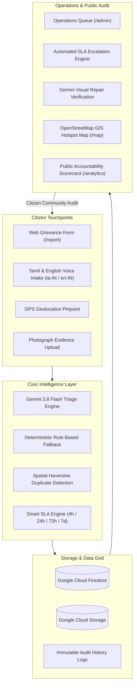

# CivicResolve — AI-Powered Citizen Grievance Intelligence & Municipal Accountability Platform

**CivicResolve** is a production-grade, full-stack municipal grievance intelligence system bridging citizens and public administration. Designed with the **Warm Civic Daylight** design language, it connects the entire civic infrastructure problem lifecycle:

$$\text{Citizen Reporting} \rightarrow \text{AI Triage} \rightarrow \text{Duplicate Detection} \rightarrow \text{Department SLA} \rightarrow \text{Field Resolution} \rightarrow \text{AI Verification} \rightarrow \text{Citizen Confirmation}$$

---

## 🏛️ System Architecture



---

## 🌟 Key Features

### 1. Warm Civic Daylight Design System
- **Editorial Municipal Aesthetics:** Clean, high-contrast, accessible municipal theme with generous whitespace.
- **Palette:**
  - Page Background: `#FAF8F5`
  - Cards: `#FFFFFF`
  - Secondary: `#F3EFE8`
  - Civic Primary: `#1B4332`
  - Municipal Terracotta Accent: `#C85A32`
  - Neutral Borders: `#E6E1D6`
- **Typography:** `Plus Jakarta Sans` for headings, `Inter` for body text.

### 2. Intelligent Multi-Tier AI Triage
- Powered by **Google Gemini 3.8 Flash** (`@google/genai`) with structured JSON schema output and Zod validation.
- Automatically assigns categories, department routing, and priority:
  - **Critical (4-hour SLA):** Exposed live cables, open manholes, road collapses, acute flood hazards.
  - **High (24-hour SLA):** Arterial road craters, water transmission bursts, dark highway junctions.
  - **Medium (72-hour SLA):** Solid waste overflow, flickering lamps, storm drain blockages.
  - **Low (7-day SLA):** Cosmetic park equipment, faded signage.
- **Resilient Fallback:** Automatically switches to deterministic keyword heuristics with Tamil & English vocabulary if offline or without API keys.

### 3. Tamil & English Voice Reporting
- Uses the browser **Web Speech API** (`SpeechRecognition`) supporting **Tamil (`ta-IN`)** and **English (`en-IN`)**.
- Transcripts are parsed by Gemini to auto-generate a structured title, description, category, and English translation while preserving original Tamil text.

### 4. Interactive GIS Map with Hotspot Detection
- Built with **Leaflet** + **React-Leaflet** and free OpenStreetMap tiles (no paid API keys required).
- Dynamic client-side loading (`next/dynamic` with `ssr: false`) to ensure 100% Next.js SSR build safety.
- Color-coded priority pins (`L.divIcon`) with live popover inspection.
- **Hotspot Density Layer:** Circles highlighting recurring issue clusters (e.g. OMR Highway corridor, Velachery basin).
- Separate **Unlocated Grievances** list for privacy-preserving manual landmarks without GPS coordinates.

### 5. Smart SLA & Automatic Escalation Engine
- Calculates hard deadlines upon submission (`calculateSLADeadline`).
- Live `SLAIndicator` displaying countdown timers and overdue badges.
- **Automated Escalation Endpoint (`POST /api/admin/escalate`):**
  - Compatible with Cloud Scheduler or manual administrator execution.
  - Elevates overdue issues through 4 tiers: Level 0 (Dept Queue) → Level 1 (Supervisor) → Level 2 (Municipal Admin) → Level 3 (Senior Authority).

### 6. AI-Assisted Resolution Verification & Citizen Audit
- Field engineers upload after-repair photographs and official notes in `/admin`.
- Gemini compares before-and-after evidence and returns structured verdicts (`Likely Resolved`, `Possibly Incomplete`, `Unable to Verify`, `Requires Manual Review`).
- Moves complaints to **`Awaiting Verification`** for mandatory citizen audit:
  - **Confirm Resolved:** Marks grievance permanently resolved and records timestamp.
  - **Dispute / Reopen:** Citizen provides feedback, reverting grievance to `Reopened` for supervisor rework.

### 7. Public Department Scorecards & Predictive Analytics
- Computes real-time telemetry from Firestore: Total Assigned, Pending, Overdue, Turnaround, and SLA Compliance %.
- Clearly distinguishes **Admin-Marked Resolved**, **AI-Verified**, and **Citizen-Confirmed** closures.
- **Predictive Recommendations:** Detects recurrent infrastructural patterns and surfaces data-backed preventative interventions with exact case counts.

---

## 🚀 Quickstart Guide

### Prerequisites
- Node.js 20+ or 22+ LTS
- npm 10+

### 1. Installation
Clone the repository and install dependencies:

```bash
git clone https://github.com/your-org/civic-resolve.git
cd civic-resolve
npm install --legacy-peer-deps
```

### 2. Environment Variables
Copy `.env.example` to `.env.local`:

```bash
cp .env.example .env.local
```

Default configuration in `.env.local`:

```env
GEMINI_API_KEY=PASTE_YOUR_GEMINI_API_KEY_HERE
GEMINI_MODEL=gemini-3.8-flash
GOOGLE_CLOUD_PROJECT=project-0ddb5f85-943e-41d9-890
GCS_BUCKET_NAME=civic-resolve-photos-soumith
ADMIN_SECRET=CivicResolve2026!
NEXT_PUBLIC_APP_URL=http://localhost:3000
```

> **Note:** The platform works **100% out-of-the-box** using the deterministic municipal triage engine. If a valid `GEMINI_API_KEY` is provided, it automatically switches to live Gemini 3.8 Flash.

### 3. Run Development Server
```bash
npm run dev
```

Open **[http://localhost:3000](http://localhost:3000)** in your browser.

---

## 🧪 Testing & Verification

Run the comprehensive unit and integration test suite:

```bash
npm test
```

Run TypeScript strict typecheck:

```bash
npx tsc --noEmit
```

Build production bundle:

```bash
npm run build
```

---

## 🚢 Google Cloud Run Deployment

CivicResolve is pre-configured with a multi-stage production `Dockerfile` listening on `PORT=8080`.

### 1. Build and Submit to Google Artifact Registry
```bash
gcloud builds submit --tag gcr.io/YOUR_PROJECT_ID/civic-resolve:latest
```

### 2. Deploy to Cloud Run
```bash
gcloud run deploy civic-resolve \
  --image gcr.io/YOUR_PROJECT_ID/civic-resolve:latest \
  --platform managed \
  --region asia-south1 \
  --allow-unauthenticated \
  --set-env-vars GEMINI_API_KEY="YOUR_KEY",ADMIN_SECRET="CivicResolve2026!"
```

### 3. Schedule Daily SLA Escalation
Use Google Cloud Scheduler to trigger the escalation engine periodically:

```bash
gcloud scheduler jobs create http civic-sla-escalation \
  --schedule "0 */4 * * *" \
  --uri "https://YOUR_CLOUD_RUN_URL/api/admin/escalate" \
  --http-method POST \
  --headers "Authorization=Bearer CivicResolve2026!"
```

---

## 🔒 Security & Privacy Practices
- **No Private Citizen Coordinates Exposed:** Strict bounding for public maps; unlocated complaints are displayed in an address-only list.
- **Server-Side Authentication:** Protected administrative routes enforce secure `httpOnly`, `sameSite: 'lax'` session cookies.
- **Input Sanitization:** Every API endpoint validates payloads using Zod schemas.
- **Prompt Injection Resilience:** User descriptions and photo inputs are treated as untrusted text within Gemini prompt templates.
- **Security Headers:** Configured with `nosniff`, `DENY` frame options, and `strict-origin-when-cross-origin` referrer policy in `next.config.ts`.
