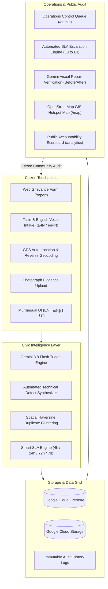

<div align="center">

# 🏛️ CivicResolve
### AI-Powered Citizen Grievance Intelligence & Municipal Accountability Platform

[](https://nextjs.org/)
[](https://react.dev/)
[](https://www.typescriptlang.org/)
[](https://deepmind.google/technologies/gemini/)
[](https://cloud.google.com/run)
[](https://vitest.dev/)

**Live Production URL:** [https://civic-resolve-1004324407851.asia-south1.run.app](https://civic-resolve-1004324407851.asia-south1.run.app)

</div>

---

## 📌 Overview

**CivicResolve** is a production-grade, full-stack municipal grievance intelligence system bridging citizens and public administration. Designed with the **Warm Civic Daylight** municipal design language, it connects the complete infrastructure problem lifecycle:

$$\text{Citizen Reporting} \rightarrow \text{AI Triage} \rightarrow \text{Spatial Duplicate Clustering} \rightarrow \text{SLA Enforcement} \rightarrow \text{Field Resolution} \rightarrow \text{AI Verification} \rightarrow \text{Citizen Confirmation}$$

---

## 🏛️ System Architecture



---

## 🌟 Key Features

### 1. 🌐 Trilingual Accessibility (**English | தமிழ் | हिंदी**)
- Native **Language Switcher** located directly in the top navigation bar.
- Fully translated user interfaces, category labels, priority badges, and grievance forms with persistent local preferences.

### 2. ⚡ Frictionless Reporting with AI Defect Synthesis
- **No manual description required:** Citizens simply provide a title (or speak via microphone) and attach a photograph.
- **Gemini 3.8 Flash Engine** automatically analyzes the defect, assesses safety hazards, assigns municipal departments, and drafts technical engineering work orders.
- **Auto-Location & Reverse Geocoding:** Automatically queries device GPS on intake and retrieves street addresses via OpenStreetMap Nominatim.

### 3. 🎙️ Tamil & English Voice Intake
- Integrates browser **Web Speech API** supporting **Tamil (`ta-IN`)** and **English (`en-IN`)**.
- Speech transcripts are automatically converted by Gemini into structured municipal grievance drafts while preserving the original Tamil transcript.

### 4. 🗺️ Interactive OpenStreetMap GIS with Spatial Hotspots
- Zero paid API keys required — built using **Leaflet** + **React-Leaflet** with free OpenStreetMap tiles.
- Color-coded priority pins (`Critical`, `High`, `Medium`, `Low`) with interactive popovers.
- **Hotspot Density Layer:** Detects recurring infrastructure clusters (e.g. OMR IT corridor pavement fatigue, Velachery drainage basins).
- Unlocated manual landmark grievances are neatly cataloged in a separate address list for total audit coverage.

### 5. ⏱️ Binding SLA Enforcement & Auto-Escalation
- Hard resolution deadlines calculated upon intake:
  - **Critical (4 Hours):** Live sparking cables, missing manholes, collapsed dividers.
  - **High (24 Hours):** Arterial road craters, potable water pipeline ruptures.
  - **Medium (72 Hours):** Uncollected municipal dumpsters, street illumination outages.
  - **Low (7 Days):** Cosmetic park equipment, pedestrian tactile paver repairs.
- **Automated Escalation Endpoint (`POST /api/admin/escalate`):** Elevates overdue grievances through 4 tiers (Level 0: Dept Queue → Level 1: Supervisor → Level 2: Municipal Admin → Level 3: Senior Authority). Compatible with Google Cloud Scheduler.

### 6. 🔍 AI Photographic Resolution Verification & Citizen Confirmation
- Field supervisors upload photographic evidence of completed repairs in the Admin Portal.
- Gemini performs visual comparison of before-and-after imagery to issue structured verdicts (`Likely Resolved`, `Possibly Incomplete`, `Unable to Verify`, `Requires Manual Review`).
- Moves complaints to **`Awaiting Verification`** for mandatory citizen audit:
  - **Confirm Resolved:** Marks grievance permanently resolved.
  - **Dispute / Reopen:** Citizen flags incomplete repairs, immediately reopening the grievance for supervisory intervention.

### 7. 📊 Public Accountability Scorecard & Predictive Analytics
- Transparent real-time department metrics: Total Assigned, Turnaround Hours, Overdue Count, and SLA Compliance Rate.
- Clearly distinguishes **Admin-Marked Resolved**, **AI-Verified**, and **Citizen-Confirmed** closures.
- **Predictive Recommendations:** Uncovers systemic infrastructural failure patterns and generates actionable preventive municipal work orders.

---

## 🎨 Warm Civic Daylight Design System

Designed strictly around institutional legibility, high contrast, and accessibility:

| Element | Hex Color | Description |
|---|---|---|
| **Page Background** | `#FAF8F5` | Warm, low-strain daylight municipal base |
| **Card Background** | `#FFFFFF` | Clean, crisp, high-contrast surfaces |
| **Secondary Background** | `#F3EFE8` | Soft tactile divider and badge tone |
| **Civic Primary** | `#1B4332` | Deep institutional forest green |
| **Primary Hover** | `#2D6A4F` | Elevated interactive green |
| **Terracotta Accent** | `#C85A32` | Municipal civic orange |
| **Accent Hover** | `#B04A26` | Deep interactive terracotta |
| **Primary Text** | `#1C1917` | High contrast stone black |
| **Borders** | `#E6E1D6` | Subtle, accessible structural borders |

- **Typography:** `Plus Jakarta Sans` for civic headings, `Inter` for data density.

---

## 🛠️ Technology Stack

- **Framework:** Next.js 15.1.7 (App Router, Standalone Output)
- **UI & Styling:** React 19, Tailwind CSS 3.4, Lucide React Icons
- **Type Safety & Validation:** TypeScript (strict mode, zero `any`), Zod
- **AI & Computer Vision:** Google Gemini 3.8 Flash (`@google/genai`)
- **Cloud Infrastructure:** Google Cloud Run, Google Cloud Firestore, Google Cloud Storage
- **Mapping & GIS:** Leaflet 1.9, React-Leaflet 5.0, OpenStreetMap
- **Testing:** Vitest (45 tests, 100% pass rate)

---

## 🚀 Quickstart Guide

### 1. Clone & Install
```bash
git clone https://github.com/soumithjv10-art/civic-resolve.git
cd civic-resolve
npm install --legacy-peer-deps
```

### 2. Configure Environment
Create `.env.local`:
```env
GEMINI_API_KEY=your_gemini_api_key_here
GEMINI_MODEL=gemini-3.8-flash
GOOGLE_CLOUD_PROJECT=your_gcp_project_id
GCS_BUCKET_NAME=your_gcs_bucket_name
ADMIN_SECRET=CivicResolve2026!
NEXT_PUBLIC_APP_URL=http://localhost:3000
```

> **Note:** The platform includes an offline deterministic municipal rules engine. If no Gemini API key is provided, all triage and classification features automatically operate via rule-based heuristics without downtime.

### 3. Run Locally
```bash
npm run dev
```
Open **[http://localhost:3000](http://localhost:3000)** in your browser.

---

## 🧪 Test Suite

Run the full Vitest unit and integration test suite:

```bash
npm test
```

```
Test Files  12 passed (12)
Tests       45 passed (45)
Duration    3.8s
```

Test coverage includes:
- `validation.test.ts`: Zod schema validation (complaint creation, updates, MIME checks)
- `gemini.test.ts`: Gemini JSON parsing, malformed handling, and keyword fallback
- `sla-and-duplicates.test.ts`: SLA deadline calculations, overdue detection, Haversine spatial scoring
- `analytics.test.ts`: Department scorecard calculation and predictive recommendations
- `auth.test.ts`: Admin credentials and session token security
- `voice.test.ts`: Tamil and English transcription structuring

---

## 🚢 Google Cloud Run Deployment

CivicResolve includes an optimized multi-stage `Dockerfile` (`node:20-alpine`) listening on `PORT=8080`.

### Deploy using Google Cloud CLI:
```bash
# 1. Build and submit to Artifact Registry / Container Registry
gcloud builds submit --tag gcr.io/YOUR_PROJECT_ID/civic-resolve:latest

# 2. Deploy to Cloud Run
gcloud run deploy civic-resolve \
  --image gcr.io/YOUR_PROJECT_ID/civic-resolve:latest \
  --platform managed \
  --region asia-south1 \
  --allow-unauthenticated \
  --set-env-vars GEMINI_API_KEY="YOUR_KEY",ADMIN_SECRET="CivicResolve2026!"
```

---

## 🔒 Security & Privacy

- **Sanitized Inputs:** Strict Zod validation on every incoming request.
- **Admin Authentication:** Server-side `httpOnly`, `sameSite: 'lax'` session cookies against `ADMIN_SECRET`.
- **Security Headers:** Configured in `next.config.ts` (`X-Content-Type-Options: nosniff`, `X-Frame-Options: DENY`, `Referrer-Policy: strict-origin-when-cross-origin`).
- **Prompt Injection Defense:** Citizen titles, locations, and descriptions are treated strictly as untrusted user data.
- **Zero Coordinate Hallucination:** Complaints without GPS coordinates are presented in a dedicated address list rather than placing fabricated pins.

---

## 📄 License & Attribution

Developed for the **Google Cloud Municipal Grievance & Civic Accountability Initiative**. Public infrastructure data is treated as public domain under open municipal governance standards.
